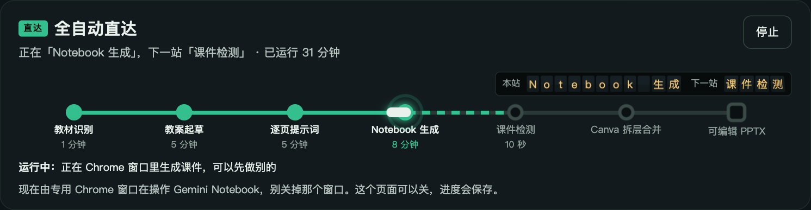

# 课件超级工作台 · Hey Teacher 小鱼老师

教材进去，出来一份**每个字都能改**的课件。

在自己的 Mac 上把一节课串成一条线：教材页 → 教案 → 逐页提示词 → Gemini Notebook 生成课件 → Canva Magic Layers 拆成可编辑图层 → 一份能改的 PPTX。它想解决的问题是：AI 做出来的课件每一页都是图片，一个字都改不了。



## 能做什么

- **全自动**：放入教材页（或你自己写好的教案），选课时和页数，点「发车」，7 站自动跑完；中途需要你确认的事会停站等你，点「继续」从停下的地方接着开。
- **手动**：教材、教案、提示词、Notebook 生成、拆层合并五个节点，每一步自己把关；也可以只用其中一步，比如把一份改不动的课件拆成可编辑图层。
- 支持 12 个学科；整本教材 PDF 可以只取本课时的页；内置「创意详案」教案写法。
- 六种界面外观：地铁线路、黑板粉笔、赛博朋克、彩色手绘、黑白素描、一本正经。
- 课程资料只保存在你自己的电脑上。

## 老师：下载和安装

1. 在本页右侧的 **Releases** 里下载最新的 `课件超级工作台-v1.0.0.zip`。
   请不要用绿色按钮 Code → Download ZIP：那样下载的文件夹里，双击安装和启动的脚本会失效。
2. 解压，把整个文件夹放进「文稿」。
3. 双击「安装依赖.command」，装好后双击「启动工作台.command」，浏览器会打开工作台。

包里的《安装说明.pdf》（一页）和《使用指南.pdf》（带截图的完整步骤、停站处理、常见问题）讲得更详细。

需要自己准备：一台 Mac、Python 3.11 或更新（安装脚本会检查并提示）、DeepSeek API key、Google Chrome 和能使用 Gemini Notebook 的 Google 账号；拆层还需要你自己的 Canva 开发者应用（可选）。这些服务的费用和额度由使用者自己承担。

## 开发者

```bash
python3.12 -m venv .venv
.venv/bin/pip install -r requirements-community.txt
.venv/bin/python web/local_server.py 8792
```

然后打开 http://127.0.0.1:8792 。DeepSeek key 写在 `config.local.json`（`{"deepseek_key": "..."}`）或环境变量 `DEEPSEEK_API_KEY` 里。课程数据保存在 `data/local_workbench/`。这两个位置都已写进 `.gitignore`，不会被提交。

| 目录 | 内容 |
| --- | --- |
| `web/` | 本地服务（`local_server.py`）、网页（`workbench.html`）、全自动流程、Canva 与 Notebook 接入 |
| `common/` | 文档解析、OCR、教案与提示词生成、来源 PDF |
| `docs/guide/` | 两份 PDF 指南的 HTML 源文件和截图 |

## 这个版本的边界

- 只支持 macOS。
- Canva Magic Layers 是 Canva 的预览接口，不保证每个账号都能用；拆层会用到你账号的 AI 额度。
- 自动操作 Gemini Notebook 依赖它的网页，页面改版时可能需要手动完成那一步。
- 不包含教材人物图片，也没有人物自动提取；可以在工作台里手动填写人物描述。
- 生成教案时，教材和教案文字会发给 DeepSeek。请不要在里面放学生的姓名、照片等个人信息。

## 许可证

代码按 **GNU Affero General Public License v3.0（AGPL-3.0）** 发布，全文见 [LICENSE](LICENSE)。本项目使用了同样采用 AGPL 的 PyMuPDF。

你可以自由使用、修改和再发布本项目；如果再发布修改后的版本，或者把修改后的版本作为网络服务提供给别人使用，需要同样以 AGPL-3.0 公开完整源码。

第三方库和字体的许可见 [THIRD_PARTY_NOTICES.md](THIRD_PARTY_NOTICES.md)。

「Hey Teacher」「小鱼老师」这两个名称和小鱼 Logo 不在开源授权范围内，见 [TRADEMARK.md](TRADEMARK.md)。

## 反馈

在 Issues 里提交问题，请附上截图、卡在第几步、你刚才做了什么。

Copyright (C) 2026 Hey Teacher · 小鱼老师
